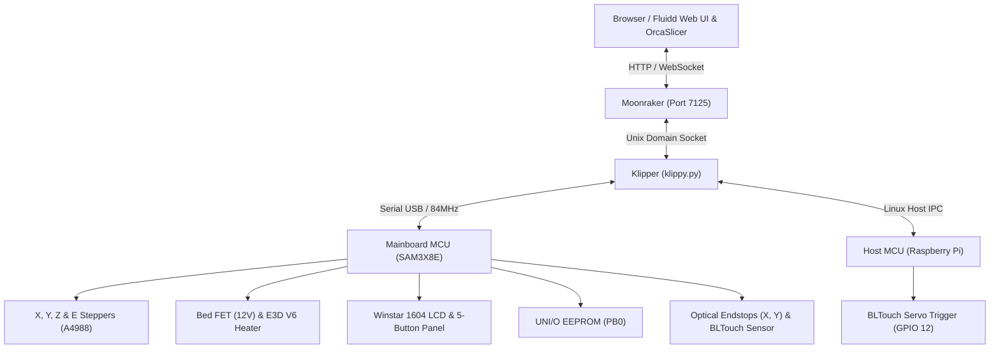

# XYZ Da Vinci 1.0A — Klipper Modernization & Architecture Guide

A fully modernized, high-performance conversion of the **XYZprinting Da Vinci 1.0A** 3D printer running **Klipper**, **Moonraker**, and **Fluidd**. 

This document serves as the master reference manual for the printer's hardware architecture, pinouts, kinematic limits, operational workflows, and historical optimization roadmap.

---

## Table of Contents
1. [System Overview & Architecture](#1-system-overview--architecture)
2. [Hardware & Mechanical Subsystems](#2-hardware--mechanical-subsystems)
3. [Electronics & Pinout Reference](#3-electronics--pinout-reference)
4. [Kinematics & Motion Limits](#4-kinematics--motion-limits)
5. [Extrusion & Thermal Architecture](#5-extrusion--thermal-architecture)
6. [Bed Probing, Leveling & Homing](#6-bed-probing-leveling--homing)
7. [Front Panel Display & Button Controls](#7-front-panel-display--button-controls)
8. [Smart Filament Cartridge System (UNI/O EEPROM)](#8-smart-filament-cartridge-system-unio-eeprom)
9. [Slicer Profiles & Settings (OrcaSlicer / Cura)](#9-slicer-profiles--settings-orcaslicer--cura)
10. [Standard Operating Procedures & Context](#10-standard-operating-procedures--context)
11. [Repository File Map](#11-repository-file-map)
12. [Optimization History & Engineering Roadmap](#12-optimization-history--engineering-roadmap)

---

## 1. System Overview & Architecture

The stock Da Vinci 1.0A platform (originally equipped with proprietary firmware, a slow direct-drive extruder, opto-mechanical bed switches, and an unheated chamber) has been converted into a rigid, enclosed, high-speed Cartesian machine:

* **Host Computer:** Raspberry Pi running Linux, Moonraker (`http://octopi.local:7125`), and the Fluidd Web UI (`http://octopi.local`).
* **Mainboard MCU:** Stock Atmel/Microchip **SAM3X8E** (Arduino Due architecture, 84 MHz ARM Cortex-M3) connected via high-speed USB serial (`/dev/serial/by-id/usb-Arduino__www.arduino.cc__Arduino_Due_Prog._Port...`).
* **Host MCU (`mcu host`):** Raspberry Pi GPIO / Linux MCU controlling the BLTouch servo control pin.
* **Firmware:** Klipper with multi-MCU synchronization, input shaping, skew correction, firmware retraction, native adaptive meshing, and custom C-level extensions for the proprietary Da Vinci filament EEPROM.



---

## 2. Hardware & Mechanical Subsystems

### 2.1 Chassis & Motion System
* **Kinematics:** Cartesian ($X, Y, Z$).
* **X Axis:** Lightweight moving toolhead carriage riding on dual horizontal precision ground steel rods driven by a short GT2 timing belt. Moving mass is $\sim 250\text{–}300\,\text{g}$.
* **Y Axis:** Dual parallel GT2 belts linked via a rigid steel cross-shaft driving the entire X-gantry assembly (stepper motor, dual rods, idlers, toolhead). Moving mass is $\sim 1,200\text{–}1,500\,\text{g}$ ($4\text{–}5\times$ heavier than X).
* **Z Axis:** Single central rear NEMA-17 stepper motor driving a precision lead screw flanked by dual vertical linear guide rods.
* **Cleaning Chute & Wipe Zone:** Rear-right corner wiper chute located at $X > 190, Y > 190$. During nozzle preparation, the toolhead scrubs against a copper/silicone wiper blade and purges into a collection chute.

### 2.2 Build Surface
* **Under-Bed:** 12V 120W PCB trace heater bonded to an aluminum heat-distribution plate.
* **Build Plate:** High-temperature rubberized magnetic base installed over the aluminum bed, supporting a removable, double-sided **textured/smooth Spring Steel PEI sheet**.
* **Bed Leveling:** 3-point thumbscrew mount (Rear-Right, Rear-Left, Front-Center) supported by high-tension compression springs.

---

## 3. Electronics & Pinout Reference

All pin references for the onboard Atmel SAM3X8E MCU:

| Subsystem | Signal / Function | Pin | Notes |
| :--- | :--- | :--- | :--- |
| **X Stepper** | Step / Dir / Enable | `PD5` / `PD4` / `!PD6` | A4988 driver, 16 microsteps, 80 steps/mm |
| **Y Stepper** | Step / Dir / Enable | `PD9` / `PB8` / `!PD6` | A4988 driver, 16 microsteps, 80 steps/mm |
| **Z Stepper** | Step / Dir / Enable | `PD0` / `PD1` / `!PD6` | A4988 driver, 16 microsteps, 2560 steps/mm |
| **Extruder** | Step / Dir / Enable | `PA0` / `PB5` / `!PD6` | E3D Bowden, 16 microsteps, ~98 steps/mm |
| **Endstops** | X Endstop / Y Endstop | `^PC3` / `^PC2` | Optical flag switches, active-low pull-up |
| **Bed Probe** | BLTouch Sensor / Servo | `^PB22` / `host:gpiochip0/gpio12` | Sensor pin on SAM3X8E, Servo pulse on Pi GPIO 12 |
| **Heated Bed** | FET Gate / Thermistor | `PB16` / `PB21` | Watermark bang-bang, custom `DAVINCI_BED_ADC` (4.096V ref) |
| **Hotend** | Heater FET / Thermistor | `PA16` / `PB20` | ATC Semitec 104GT-2 thermistor (PID controlled) |
| **Cooling** | Part Fan / System Fan | `PB4` / `PC26` | `PB4` = Print cooling fan, `PC26` = Board/MCU fan |
| **Display** | RS / E / D4–D7 | `PB24`, `PA13`, `PA25`–`PA27` | Winstar 1604A (HD44780, 8-bit parallel bus) |
| **Buttons** | Up / Down / Back / OK | `^!PC19`, `^!PC29`, `^!PA26`, `^!PA27` | Active-low with internal pull-up and debounce |
| **Home Button**| Physical Front Panel | `^!PA28` | Repurposed dedicated Home G-code button (`HOME_BUTTON`) |
| **EEPROM** | Filament Cartridge 1 | `^PB0` | UNI/O 1-wire serial SCIO line (`[xyz_cartridge]`) |
| **Lighting** | Case Chamber LED | `PC18` | `[output_pin Case_Light]` via `LIGHTS_ON` / `LIGHTS_OFF` |
| **Buzzer** | Piezo Beeper | `PB15` | Hardware PWM buzzer via `M300` |

---

## 4. Kinematics & Motion Limits

The printer's motion envelope was scientifically tuned using the `klipper_auto_speed` module to identify real-world step-loss boundaries and derated by 20% for flawless production reliability:

```ini
[printer]
kinematics: cartesian
max_velocity: 195           # Tested limit: 245 mm/s (0.8 derate)
max_accel: 3000             # Tested limit: 3927 mm/s² (3x increase over stock 1000)
max_z_velocity: 5           # Central lead screw ceiling
max_z_accel: 100            # Central lead screw ceiling
square_corner_velocity: 5.0
```

### Motion Boundary Limits
* **X Range:** `0.0` to `200.0 mm` (Printable bed: $X \in [0, 190]$).
* **Y Range:** `0.0` to `240.0 mm` (Printable bed: $Y \in [0, 200]$; Wiper chute: $Y \in [200, 240]$).
* **Z Range:** `0.0` to `200.0 mm`.

---

## 5. Extrusion & Thermal Architecture

### 5.1 E3D V6 Bowden Extrusion
* **Hotend:** Genuine E3D V6 all-metal hotend (copper heater block, 30W/40W cartridge, ATC Semitec 104GT-2 sensor).
* **Nozzle:** 0.40 mm standard brass nozzle.
* **Feed Path:** Bowden feeder with a $\sim 500\,\text{mm}$ PTFE guide tube from the rear chassis bracket.
* **Retraction Baseline:** `3.5 mm` length at `40 mm/s` retract and `35 mm/s` unretract.
* **Pressure Advance:** Calibrated baseline in Klipper is `0.31` (tuned via OrcaSlicer PA Tower for ABS).
* **Max Volumetric Speed:** Safe operational ceiling is **`13.0 mm³/s`** for ABS at 245 °C.

### 5.2 Heated Bed & Magnetic PEI Surface
* **Heater Type:** 12V 120W PCB trace heater under aluminum.
* **Control Mode:** `watermark` (bang-bang). High-frequency PID PWM is intentionally disabled because the stock mainboard power rail and MOSFET driver cannot support rapid PWM cycling without voltage droop.
* **ADC Electrical Filtering (`smooth_time: 8.0`):** The Da Vinci mainboard's shared ground plane causes ground-bounce and voltage droop when the 12A bed heater activates. An 8-second low-pass moving average filter is applied to `[heater_bed]` to completely eliminate false ADC temperature spikes without adding control latency.
* **Thermal Watchdog (`check_gain_time: 200`):** Because the rubber magnetic sticker acts as a thermal barrier, heat transfer into the spring steel plate slows down in cold rooms. `check_gain_time` is configured to 200 seconds to allow the heater to climb steadily without triggering safety halts.

---

## 6. Bed Probing, Leveling & Homing

```
                     Rear Wiper Chute (X205, Y215)
                             [CHUTE]
    (Y=180) ┌───────────────────────────────────────┐
            │  [Screw 2: Rear Left]   (100, 175)    │ [Screw 1: Rear Right]
            │       (40, 170)        *Z-HOME POINT* │       (220, 170)
            │                         (Probe Zero)  │
            │                                       │
            │                                       │
            │            PRINT SURFACE              │
            │              (190 x 200)              │
            │                                       │
            │                                       │
            │                                       │
            │            [Screw 3: Front]           │
    (Y=20)  │               (130, 20)               │
            └───────────────────────────────────────┘
            (X=20)                                (X=170)
                             FRONT DOOR
```

### 6.1 Back-Center Rigid Z-Homing (`[homing_override]`)
Instead of homing in the front or rear corners (which induces bed flex and torque on the cantilever arms), homing is performed at **back-center (`X=140, Y=175` -> BLTouch probe at `100, 175`)**. This places the probe directly over the central Z lead screw and between the two vertical guide rods for maximum mechanical stiffness.
* **Collision-Free Safe Corridor:** The `[homing_override]` drops Z by 10 mm, homes X and Y, steps out of the wiper chute along safe corridors, homes Z at `(140, 175)`, and parks safely on the bed surface at `(190, 200)`.

### 6.2 Bed Mesh & Adaptive Meshing
* **Probe Offsets:** $X = -40.0\,\text{mm}$, $Y = 0.0\,\text{mm}$, $Z \approx 0.815\,\text{mm}$.
* **Zero Reference Position:** Hardcoded to `100, 175` so the mesh matrix is mathematically zeroed against the exact physical point where Z was homed.
* **Adaptive Meshing:** `START_PRINT` invokes `BED_MESH_CALIBRATE ADAPTIVE=1`. Klipper reads the G-code object bounding box from Moonraker and only probes the exact footprint of the active print job.
* **Fade Height:** Mesh height compensation fades out smoothly from $Z = 1.0\,\text{mm}$ to $Z = 10.0\,\text{mm}$ (`fade_start: 1.0`, `fade_end: 10.0`, `fade_target: 0`), preventing wavy vertical walls on tall parts.

### 6.3 Bed Screws Tilt Adjustment (`SCREWS_TILT_CALCULATE`)
The 3 bed thumbscrews are mapped in Klipper (`screw_thread: CCW-M3`):
1. **Rear-Right (Base reference):** `X=220, Y=170`
2. **Rear-Left:** `X=40, Y=170`
3. **Front-Center:** `X=130, Y=20`

Run `SCREWS_TILT_CALCULATE` in Fluidd or click **Bed Tilt $\to$ Measure Tilt** on the front panel display. Klipper will probe all 3 screws and report exact adjustments in clock-minutes (e.g. `CW 00:15`).

---

## 7. Front Panel Display & Button Controls

The Da Vinci’s front panel features a **Winstar 1604A 16x4 character LCD** and a 5-button tactile pad.

### 7.1 Electrical Pull-Up & Home Button Fix
* **Button Inputs:** Stock buttons short to ground when pressed. Configured with internal hardware pull-ups and inversion (`^!PC19`, `^!PC29`, `^!PA26`, `^!PA27`).
* **Home Button Repurposing:** The physical Home button (`PA28`) was originally hardwired to Klipper's `kill_pin`, causing accidental emergency printer halts. It has been converted to an event button (`[gcode_button home_button]`) triggering `HOME_BUTTON`:
  * Homes axes (`G28`) if the machine is idle.
  * Ignored with an informative console alert if a print is actively executing, preventing accidental job termination.

### 7.2 Custom On-Screen Menu Hierarchy (`display_menu.cfg`)
* **Live Print Controls:** Prominently displays `Pause Print`, `Resume Print`, and `Cancel Print` at the top level during active prints.
* **Live Filament Cartridge Stats:** Displays real-time spool Material, Color, Remaining Length (m), and recommended print temps directly from the EEPROM chip.
* **Cartridge Programmer Submenu (`Set Cartridge >`):** Interactive dials allow setting material type (`PLA`, `PETG`, `ABS`, `TPU`) and remaining filament length (5m to 400m in 10m steps), then burning the data directly to the chip with confirmation beeps.
* **Interactive Bed Screws Tilt:** 1-click `Measure Tilt` probes the bed screws and displays live adjustment feedback directly on the LCD screen (`Rear L: CW 01:10`).
* **Filament Drying Suite:** Direct controls to drop the bed (`DRYER_DROP_BED`), start automated drying cycles for PLA (50°C), PETG (65°C), or ABS (70°C), and monitor cycle countdowns.

---

## 8. Smart Filament Cartridge System (UNI/O EEPROM)

The Da Vinci 1.0A includes an internal 1-wire serial reader for proprietary filament cartridges. This functionality is preserved and supercharged via Klipper's custom `[xyz_cartridge]` extension:

* **Pin:** `^PB0` (Cartridge 1 SCIO line).
* **Protocol:** Microchip UNI/O bus at 25,000 baud.
* **Continuous Tracking:** Filament consumption is measured in real time during prints and automatically written back to the EEPROM chip at checkpoints and upon print completion (`sync_on_print_end: True`).

### Management Interfaces
1. **Interactive Fluidd Modal (`CARTRIDGE_PANEL`):** Opens an interactive GUI prompt in Fluidd with live gauge meters, material info, one-click preheat, and instant 200m resets for PLA, ABS, and PETG.
2. **Visual Console Card (`CARTRIDGE_STATUS`):** Prints a formatted box-drawing card with an ASCII percentage bar (`[████████████████░░] 82.4%`) to the terminal.
3. **Front Panel Screen:** Read and reprogram spools directly via the LCD menu.

---

## 9. Slicer Profiles & Settings (OrcaSlicer / Cura)

Configured for **OrcaSlicer** (active primary) and **UltiMaker Cura** (reference).

### 9.1 Machine Limits in Slicer
Match [`klipper/printer.cfg`](file:///Users/multidest/Projects/3dprinter/Da-Vinci-1.0A/klipper/printer.cfg):
* Max X/Y Feedrate: `195 mm/s`
* Max Z Feedrate: `5 mm/s`
* Max Extruder Speed: `60 mm/s`
* Max Accelerations: `3000 mm/s²` (X, Y, Travel, Extruding)
* Max Z Acceleration: `100 mm/s²`

### 9.2 First-Layer Adhesion Settings (Cura Parity)
To ensure reliable first layers on the magnetic PEI plate:

| Setting | Value | Rationale |
| :--- | :--- | :--- |
| **Initial Layer Height** | **`0.30 mm`** | Extrudes 50% more volume than 0.20mm; bridges surface texture and retains heat. |
| **Initial Layer Line Width** | **`0.50 mm`** | 125% nozzle width; forces adjacent tracks to melt into a solid, gap-free sheet. |
| **Initial Layer Print Speed** | **`25 mm/s`** | Gives molten plastic sufficient dwell time to bond to the PEI sheet. |
| **Initial Layer Infill/Brim Speed** | **`30 mm/s`** | Prevents high-speed dragging and wavy lines on brims. |
| **First Layer Acceleration** | **`500 mm/s²`** | Gentle acceleration preventing corners from peeling up during laying. |
| **Filament Flow Ratio** | **`0.98` (98%)** | Calibrated via OrcaSlicer Archimedean chords YOLO test (-0.03 offset from 1.01). |
| **X-Y Hole Compensation** | **`+0.10 mm`** | Calibrated via Orca Tolerance Test; compensates for internal hole contraction/shrinkage without altering outer contours. |

---

## 10. Standard Operating Procedures & Context

### 10.1 Bed Heating in Cold Ambient Weather
1. **Always leave the spring steel PEI plate on the bed before preheating.** Do not place a cold plate onto a hot bed mid-cycle (prevents 3–4°C thermal shock dips).
2. **Keep the chamber door and top lid completely closed.** The Da Vinci is an enclosed printer; ambient room drafts will pull heat from the steel plate faster than the 120W heater can supply it above 75°C.
3. **Allow a 2-minute heat soak:** After Klipper reports that target temperature is reached, allow 1–2 minutes for heat to migrate through the rubber magnetic base into the steel PEI surface.

### 10.2 Safe Pause / Resume Behavior
* **12-Hour Stepper Holding:** When a print is paused (via `PAUSE` or `M600`), Klipper parks the toolhead at `(190, 200)` and cools down the hotend (`M104 S0`) to prevent oozing and heat creep. The stepper motors remain **energized for up to 12 hours** (`variable_idle_timeout: 43200`), completely preserving coordinate calibration.
* **Automatic Reheat on Resume:** Clicking `RESUME` automatically reheats the extruder to its pre-pause temperature, unretracts, and resumes printing seamlessly without requiring re-homing.

### 10.3 Print Lifecycle Execution
* **`START_PRINT` Sequence:**
  1. Bed heats to target temp; axes home (`G28`).
  2. Native adaptive bed mesh probes the model's exact footprint (`BED_MESH_CALIBRATE ADAPTIVE=1`).
  3. Toolhead parks in the wiper chute at `(205, 215, 10)` while nozzle heats up (catches drool).
  4. Purges 3 mm into the chute and executes `CLEAN_NOZZLE` across the wiper blade.
  5. Re-homes X and Y to eliminate any microsteps lost to wiper friction.
  6. Lays down a dual-line edge purge along the left bed boundary ($X=1.0\text{–}1.4$) and wipes cleanly into the print area.
* **`END_PRINT` Sequence:**
  1. Retracts 3 mm; turns off hotend and bed heaters.
  2. Lowers bed to $Z=195$ for effortless part clearance.
  3. Executes `CLEAN_NOZZLE` over the waste scraper.
  4. Parks safely on the bed surface at `(190, 200)` and disables steppers.

---

## 11. Repository File Map

```
Da-Vinci-1.0A/
├── README.md                 # Master documentation, architecture guide, and changelog
├── Tuning.md                 # Advanced mechanical asymmetry, skew correction & resonance guide
├── klipper/
│   ├── printer.cfg           # Main hardware configuration, pinout, steppers, and kinematics
│   ├── macros.cfg            # Print lifecycle, filament, lighting, and calibration macros
│   ├── display_menu.cfg      # Custom 16x4 LCD menu tree (filament stats, bed tilt, drying)
│   ├── fluidd.cfg            # Fluidd client variables, pause/resume/cancel implementations
│   └── moonraker.conf        # Moonraker API, authorization, update manager, and object processing
└── repetier/                 # Legacy Repetier firmware archive (reference only)
```

---

## 12. Optimization History & Engineering Roadmap

A chronological log of all completed engineering enhancements, safety hardening, and firmware upgrades:

### 0. Completed Baseline & Safety Fixes
* **[x] 0.1 Open-Circuit Thermistor Protection:** Set `min_temp: 0` for extruder and bed in `printer.cfg`. Protects against thermal runaway if thermistor wires break.
* **[x] 0.2 Bed Thermal Runaway Detection:** Configured `[verify_heater heater_bed]` to prevent false shutdowns while ensuring robust thermal protection.
* **[x] 0.3 LCD 1604 Display Geometry:** Configured `line_length: 16` in `[display]` to ensure proper line wrapping on the 16x4 character screen.
* **[x] 0.4 Nozzle Cleaning Macro & Legacy Alias:** Implemented `CLEAN_NOZZLE` wiper routines and mapped `M100` alias for legacy slicer compatibility.
* **[x] 0.5 Disable Part Fan During Warm-up:** Removed premature fan activation in `START_PRINT` to speed up initial heating.

### 1. Print Quality & Hardware Tuning
* **[x] 1.1 Bed Heater Control (Watermark Maintained):** Evaluated bed PID tuning; retained `control: watermark` because the mainboard FET and power supply cannot support rapid PWM cycling.
* **[x] 1.2 Back-Center Z-Homing with Cleaning Zone Routing:** Migrated Z-homing to `(140, 175)` (probe at `100, 175`) directly over the lead screw. Implemented safe corridor pathing in `[homing_override]` and synchronized `zero_reference_position`.
* **[x] 1.3 BLTouch Probing Speed Optimization:** Increased probing speed to `3.0 mm/s` and lift speed to `4.0 mm/s`, cutting mesh probing time by over 60%.

### 2. Print Lifecycle Workflows (`START_PRINT` & `END_PRINT`)
* **[x] 2.1 Adaptive Bed Meshing:** Enabled native adaptive probing (`BED_MESH_CALIBRATE ADAPTIVE=1`), probing only the active model footprint per print.
* **[x] 2.2 Purge / Priming Line Pathing:** Implemented clean dual-line bed edge priming ($X=1.0\text{–}1.4$) with automated ooze-retract and wipe-hop.
* **[x] 2.3 Streamline `END_PRINT` Redundancies:** Cleaned up end sequence: 3mm retraction, full bed drop to Z195, nozzle wipe, and park at `(190, 200)`.

### 3. Configuration Hygiene & Macro Deduplication
* **[x] 3.1 Unify Fluidd Client Macros:** Unified pause/resume/cancel logic under Fluidd's official `_CLIENT_VARIABLE` macro; eliminated duplicated config blocks.
* **[x] 3.2 Filament Dryer Loop MCU Flood Optimization:** Reduced dryer telemetry frequency from 1s to 60s, cutting command chatter by 60x and preventing timer timeouts.
* **[x] 3.3 Remove Obsolete `multiprobe_*` Macros:** Purged legacy conductive-pad probe macros; replaced with unified `SCREWS_TILT` macro.
* **[x] 3.4 Remove Obsolete `Bed_Tilt_Calibration` Macro:** Cleaned out obsolete manual calibration routines.

### 4. Modern Features & Quality of Life Enhancements
* **[x] 4.1 Enable `[exclude_object]`:** Configured object processing in Moonraker and Klipper, enabling interactive single-part cancellation during multi-part prints.
* **[x] 4.2 Case Lighting Control Macros:** Added `LIGHTS_ON`, `LIGHTS_OFF`, `LIGHTS_TOGGLE`, and `M355` macros for chamber LED control.
* **[x] 4.3 Firmware Retraction (`[firmware_retraction]`):** Implemented native firmware retraction with initial Bowden baseline (3.5mm @ 40mm/s), exposed to Fluidd sliders.

### 5. Advanced Refinements & Workflow Polish
* **[x] 5.1 Bed Mesh Height Fading:** Configured `fade_start: 1.0`, `fade_end: 10.0`, and `fade_target: 0` to prevent wavy vertical walls on tall prints.
* **[x] 5.4 Slicer Compatibility (`M600`):** Added `M600` filament swap macro forwarding directly to `PAUSE`.
* **[x] 5.5 Bowden Loading/Unloading Macros:** Added automated fast-feed and tip-shaping routines (`LOAD_FILAMENT` / `UNLOAD_FILAMENT`) for the 500mm Bowden tube.
* **[x] 5.6 Client Variable Sync:** Tuned Z-hop speed to 5.0 mm/s and enabled firmware retract passthrough in Fluidd.
* **[x] 5.7 Automated Motion Limits (`klipper_auto_speed`):** Measured physical limits ($X/Y = 3927\,\text{mm/s}^2, 245\,\text{mm/s}$) and established safe production limits ($3000\,\text{mm/s}^2, 195\,\text{mm/s}$). Patched upstream bugs for BLTouch virtual endstops and chute collision avoidance.
* **[x] 5.8 Macro Categorization & UI Organization:** Grouped macros into 5 clean, color-coded functional categories in Fluidd.
* **[x] 5.10 Front Panel Button Responsiveness Fix & Home Button Repurposing:** Added pull-up and inversion (`^!`) to front panel buttons to resolve missed clicks; converted `PA28` from a destructive kill switch to a dedicated Home button.
* **[x] 5.11 Custom Winstar 1604 Display Menus:** Built dedicated on-screen interfaces in `display_menu.cfg` for live cartridge EEPROM tracking, spool reprogramming (`Set Cartridge >`), 1-click bed screws tilt feedback, and filament drying.
* **[x] 5.12 Manual Extrusion Controls & Button Macro Anti-Queueing:** Added fine manual extrusion controls and patched button handlers to prevent queuing duplicate long-running macros.
* **[x] 5.13 Direct On-Screen Print Controls:** Exposed prominent top-level `Pause`, `Resume`, and `Cancel` controls during active prints.
* **[x] 5.14 Legacy Display Menu Overrides:** Fixed case light menu mapping, boosted baby-stepping resolution to 0.01 mm, and added modern preheats.
* **[x] 5.15 Stepper Energization During Print Pause:** Implemented conditional `[idle_timeout]` to hold stepper holding torque for 12 hours during pauses while cooling the hotend; added automatic reheat on resume.
* **[x] 5.16 Interactive Fluidd Modal for Filament Cartridge:** Implemented `CARTRIDGE_PANEL` dialog modal and `CARTRIDGE_STATUS` visual console cards.
* **[x] 5.17 OrcaSlicer First-Layer Parity with Cura:** Aligned OrcaSlicer presets with Cura standards (0.30mm layer height, 0.50mm line width, 25–30mm/s first-layer speed, 3.5mm retraction) to eliminate thin, wavy, and disconnected brims.
* **[x] 5.18 Bed Thermistor ADC Noise Filtering & Watchdog Tuning:** Increased bed `smooth_time` to 8.0s to filter out mainboard ground bounce and electrical ADC noise; tuned `check_gain_time` to 200s to accommodate magnetic PEI bed thermal lag in cold weather.
* **[x] 5.19 Empirical Pressure Advance Calibration (0.31):** Calibrated using OrcaSlicer's PA Tower on the E3D V6 Bowden setup. Identified optimal corners at height $15\text{–}16\,\text{mm}$ ($\text{PA} = 0.31$); synchronized across Klipper's `[extruder]` and OrcaSlicer ABS filament profiles.
* **[x] 5.20 Empirical Flow Ratio Calibration (0.98):** Calibrated using OrcaSlicer's Archimedean Chords YOLO test. Identified optimal top-surface finish at $-0.03$ offset from baseline ($1.01 \times 0.97 \approx 0.98$); updated across OrcaSlicer ABS filament profiles to eliminate micro-ridging and top-surface roughness.
* **[x] 5.21 X-Y Hole Precision Compensation (+0.10 mm):** Calibrated via the Orca Tolerance Test using a 6mm reference gauge. Configured `xy_hole_compensation: 0.1` across all `@MyKlipper` process presets to expand internal holes and negative features to true nominal fit without affecting outer dimensions.


